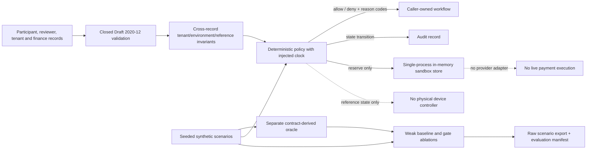

# Matrix installation-core architecture

## Context and status

This is a research prototype and executable reference policy. It is not a deployed service, physical controller, verified partner integration, or production authorization system.

## Decision and data boundaries

The canonical interface is `schemas/v0.1.0/core.schema.json`. Python is one reference implementation; consumers must validate the same language-neutral contracts and apply equivalent cross-record invariants. Closed record objects are validated before privileged decisions. Activation uses a code-owned `matrix-installation-v0.1.0` required-check set, not a caller-selected list. Every permission in the in-memory finance example is an explicit target/action/tenant/environment-scoped reference record. The source and actor identity are still caller-supplied; these records do not constitute production authentication.

Participant stop is a separate narrow operation over the target installation and actor context. It records a reference-state transition and audit event, not physical shutdown. Participant withdrawal revokes only the target installation's consents, memberships, acceptances, and referrals. No stopped installation can resume automatically.

The finance store serializes in-process state changes with one lock and validates the post-transition snapshot before committing. Its atomicity, authorization context, and idempotency are reference behavior only; there is no durable/distributed transaction or payment provider call.

## Deployment boundaries

Production identity/authentication, permission issuance and revocation, durable transactional storage, secure audit, up-to-date jurisdiction review, partner/provider agreements, physical-device validation, and independent security/privacy/accessibility review are blockers. See [`../docs/deployment-blockers.md`](../docs/deployment-blockers.md) and [`../docs/threat-model-and-data-boundaries.md`](../docs/threat-model-and-data-boundaries.md).
